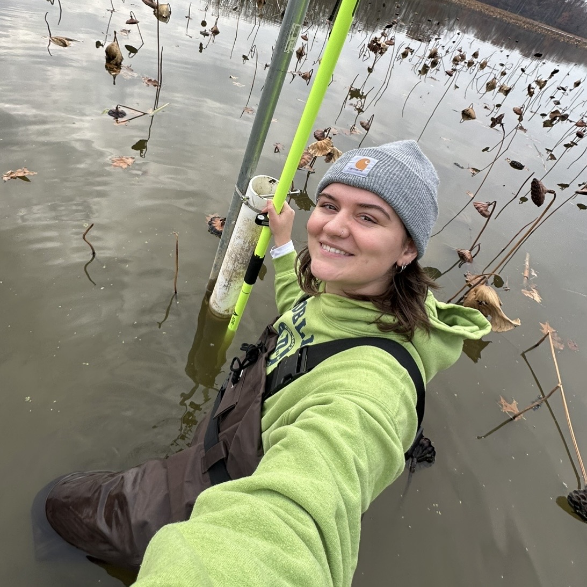
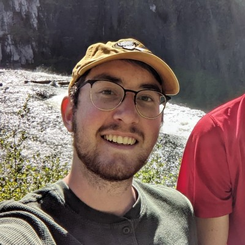
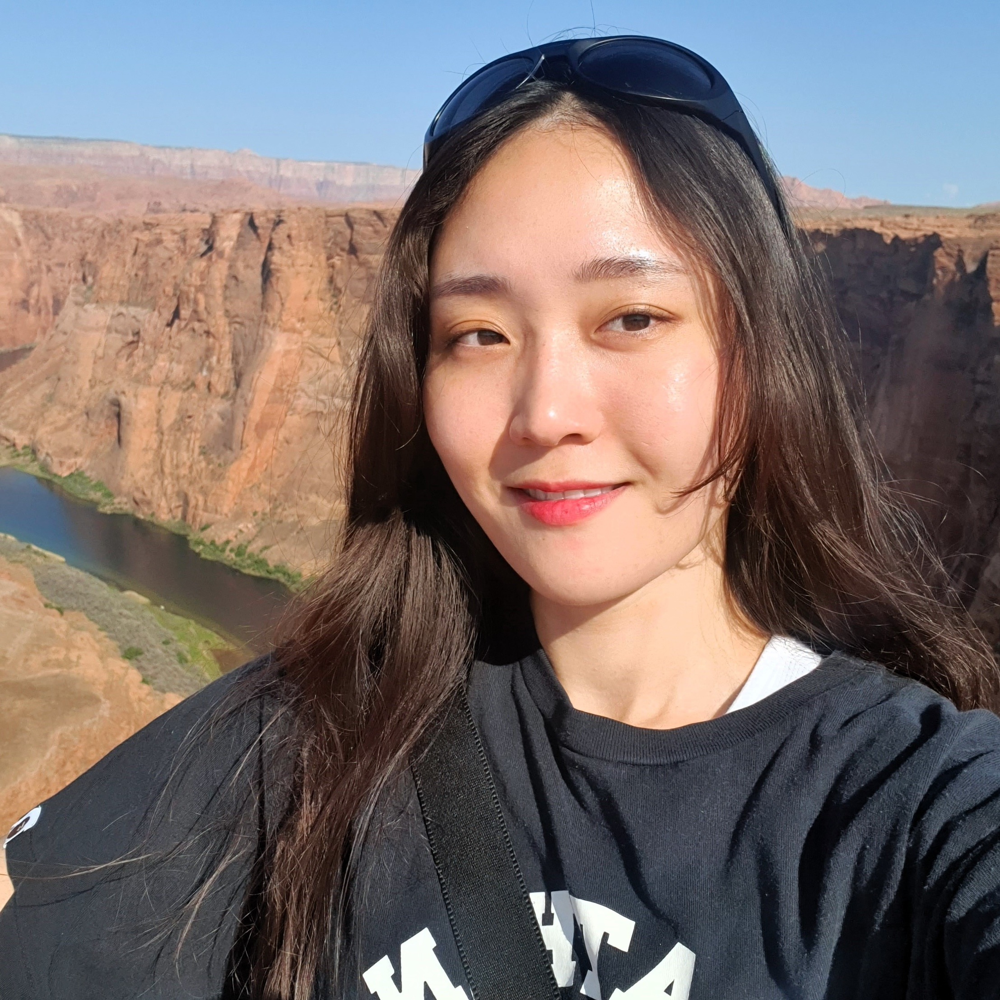
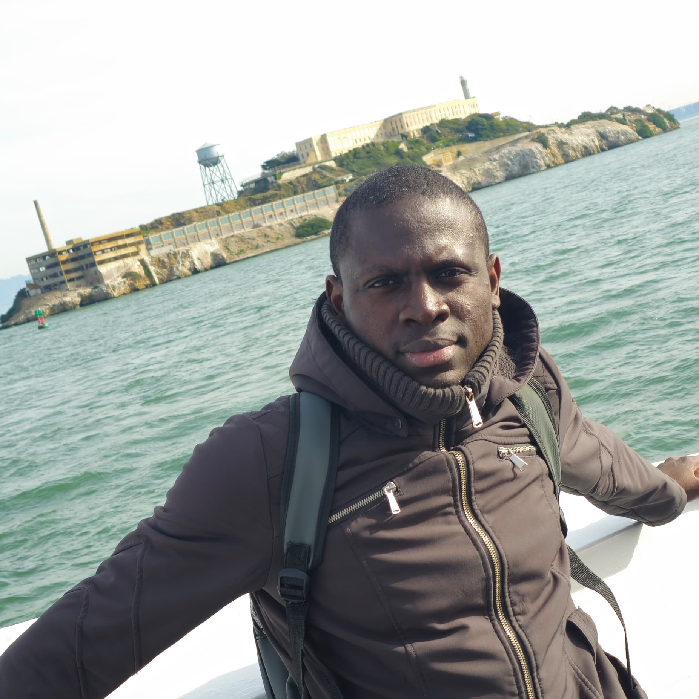
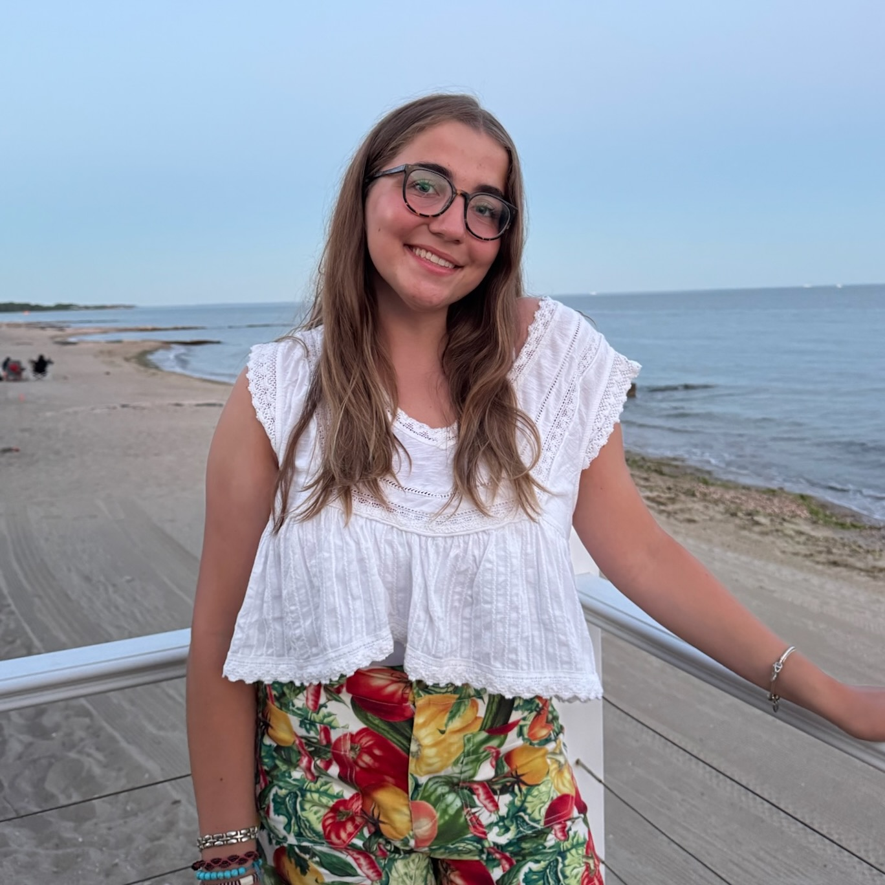

# Graduate Students

---

  
  

    <h3 style="margin-top: 0;">Alaina Foster</h3>
    
<em>M.S. Student, 2026 –</em> 
    alaina.foster@uconn.edu &nbsp;|&nbsp; <a href="https://www.linkedin.com/in/akfos/">LinkedIn</a>

    
<strong>Education</strong> 
    B.A.: Geosciences, Computer Science minor, Wellesley College (2024)

    
I am pursuing my M.S. in Geological Sciences and studying baseflow resilience in headwater streams in the Delaware River Basin. Before UConn, I worked on a project at the University of Toledo focusing on geophysical characterization and soil-water interactions in the Western Lake Erie Basin. I enjoy reading, hiking, and playing with my dog in my free time.

  

---

  
  

    <h3 style="margin-top: 0;">Noah Cadwell</h3>
    
<em>M.S. Student, 2026 –</em> 
    noah.cadwell@uconn.edu &nbsp;|&nbsp; <a href="https://www.linkedin.com/in/noah-cadwell-67b538218/">LinkedIn</a>

    
<strong>Education</strong> 
    B.S.: Geological Sciences, University of Missouri - Columbia (2023)

    
My M.S. research will focus on groundwater-surface water interactions in watersheds with beaver dams or beaver dam analogs. I will create numerical models to study water transport and water balance, integrating field observations from monitoring sites in Colorado. After my undergraduate degree, I worked as an intern for USGS and a hydrologist for a state geological survey, but I wanted to pursue a master's degree to improve my research and science communication skills. In my free time, I enjoy all sorts of tabletop games, video games, and hiking.

  

---

  
  

    <h3 style="margin-top: 0;">Yeonju Kim</h3>
    
<em>Ph.D. Student, 2024 –</em> 
    yeonju.kim@uconn.edu &nbsp;|&nbsp; <a href="https://www.linkedin.com/in/iamkimyeonju/">LinkedIn</a>

    
<strong>Education</strong> 
    M.S.: Civil and Environmental Engineering, Seoul National University, South Korea (2023) 
    B.E.: Civil Engineering, Yeungnam University, South Korea (2021)

    
I am currently pursuing my Ph.D. in the Department of Earth Sciences at the University of Connecticut. My doctoral research focuses on the hydrological impacts of beaver dams in the New England region. In particular, I study groundwater-surface water interactions through a model-data integration approach, combining field observations with computational modeling.

  

---

  
  

    <h3 style="margin-top: 0;">Victor Oladoja</h3>
    
<em>Ph.D. Student, 2024 –</em> 
    victor.oladoja@uconn.edu &nbsp;|&nbsp; <a href="https://www.linkedin.com/in/victoroladoja/">LinkedIn</a>

    
<strong>Education</strong> 
    M.S.: Geology, Kansas State University (2024) 
    B.Tech.: Applied Geology, Federal University of Technology, Akure, Nigeria (2019)

    
My Ph.D. research combines hydrology and computational geosciences with my passion for water-related issues. I focus on integrating different hydrologic techniques, including data-driven and numerical models, to characterize groundwater systems and sustainably manage water resources.

  

---

# Undergraduate Students

---

  
  

    <h3 style="margin-top: 0;">Addison Meisterling</h3>
    
<em>Undergraduate Student, Environmental Science</em> 
    addison.meisterling@uconn.edu &nbsp;|&nbsp; <a href="https://www.linkedin.com/in/addison-meisterling-138477341/">LinkedIn</a>

    
I am a junior pursuing my B.S. in Environmental Science with a concentration in Global Change and a minor in Environmental Economics and Policy. My interests include environmental law and policy, hydrological processes, and the role geography plays in climate change. Outside of academics, I enjoy spending time outdoors and creating art.

  

---

# Alumni and Previous Research Group Members

---

  <h3 style="margin-top: 0; margin-bottom: 0.2em;">Emily Rochette (she/her)</h3>
  
<em>Undergraduate Student, Earth Sciences, 2025 - 2026</em>

  <h3 style="margin-top: 0; margin-bottom: 0.2em;">Jacob Gorman (they/them)</h3>
  
<em>Undergraduate Student, Earth Sciences &amp; Computer Science, 2025</em>

  <h3 style="margin-top: 0; margin-bottom: 0.2em;">Amber Caruso</h3>
  
<em>Undergraduate Student, Environmental Engineering, 2025</em>

